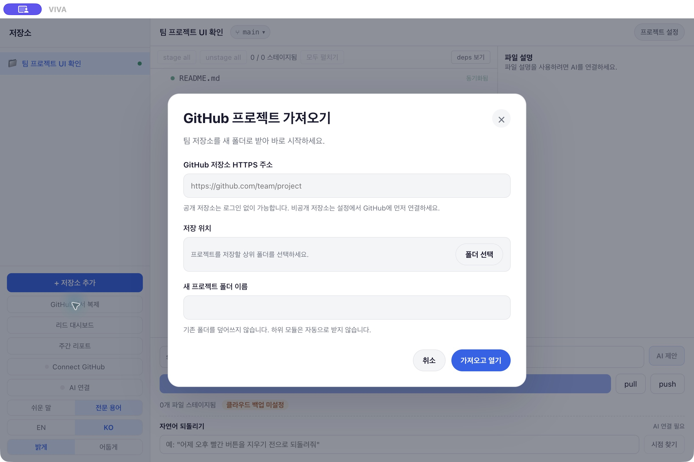

# VIVA 설치와 첫 프로젝트 사용 가이드

[English](user-guide.en.md) · [설치 파일 다운로드](https://github.com/yhkimslv/viva/releases/tag/v0.3.0-beta.1)

**VIVA 0.3.0-beta.1 팀 테스트 버전**을 기준으로 macOS·Windows 설치, GitHub 연결, 저장소 clone까지 진행합니다. Clone은 GitHub 저장소와 변경 이력을 내 컴퓨터에 내려받는 작업입니다. **터미널 명령어와 Node.js·npm은 필요하지 않습니다. Git은 별도로 설치합니다.**

진행 순서: **VIVA 설치 → Git 확인 → GitHub 로그인 → 저장소 clone → 커밋 작성자 설정 → 대시보드 확인**. 본인의 GitHub 계정과 리드가 공유한 팀 저장소 HTTPS 주소를 준비하세요. 비공개 저장소는 초대를 수락하고 접근 권한을 받아야 합니다.

## 1 설치 파일 다운로드

[릴리스 페이지](https://github.com/yhkimslv/viva/releases/tag/v0.3.0-beta.1)의 Assets에서 내 컴퓨터에 맞는 **설치 파일**을 받습니다. `Source code` 압축 파일은 설치 파일이 아닙니다.

| 컴퓨터 | 설치 파일 |
| --- | --- |
| Apple M 시리즈 Mac | [VIVA-0.3.0-beta.1-mac-arm64.dmg](https://github.com/yhkimslv/viva/releases/download/v0.3.0-beta.1/VIVA-0.3.0-beta.1-mac-arm64.dmg) |
| Intel Mac | [VIVA-0.3.0-beta.1-mac-x64.dmg](https://github.com/yhkimslv/viva/releases/download/v0.3.0-beta.1/VIVA-0.3.0-beta.1-mac-x64.dmg) |
| Windows x64 PC | [VIVA-0.3.0-beta.1-windows-x64-setup.exe](https://github.com/yhkimslv/viva/releases/download/v0.3.0-beta.1/VIVA-0.3.0-beta.1-windows-x64-setup.exe) |

Mac은 **Apple 메뉴 → 이 Mac에 관하여**에서 칩·프로세서를 확인합니다. macOS 13 이상이 필요합니다. 이번 릴리스에는 Windows ARM 전용 설치 파일이 없습니다.

이번 버전은 **팀 테스트용**으로 macOS Developer ID 서명·공증과 Windows 게시자 서명이 없습니다. macOS에는 실행을 위한 임시 서명만 적용했습니다. 첫 실행에 OS 확인이 나타날 수 있으며, 관리 기기의 정책에 따라 실행이 차단될 수 있습니다.

## 2 VIVA 설치

### macOS

1. 내려받은 DMG를 엽니다.
2. **VIVA**를 **Applications**로 드래그합니다.
3. 복사가 끝나면 Applications에서 **VIVA**를 엽니다. 설치용 DMG는 꺼내도 됩니다.
4. 확인되지 않은 개발자·미공증 안내가 나오면, 이 저장소에서 받은 팀 테스트 파일인지 확인하세요. 설치하기로 판단한 경우 **시스템 설정 → 개인정보 보호 및 보안 → 확인 없이 열기 Open Anyway**에서 해당 앱의 열기를 확인하고, 다음 창에서 **열기 Open**를 선택합니다. 이 항목은 앱을 한 번 열려고 시도한 뒤 표시됩니다. [Apple 공식 안내](https://support.apple.com/en-us/102445)

앱이 손상됐거나 컴퓨터를 손상시킨다는 경고는 일반 개발자 확인 경고와 다릅니다. 다시 내려받거나 리드에게 문의하세요. 관리 정책으로 허용할 수 없다면 서명된 배포가 필요합니다.

### Windows

1. 내려받은 `VIVA-0.3.0-beta.1-windows-x64-setup.exe`를 엽니다.
2. 설치 마법사에서 위치를 확인하고 설치를 완료합니다. 기본 설치는 현재 사용자용이며 관리자 권한을 요청하지 않습니다.
3. 바탕화면 또는 시작 메뉴에서 **VIVA**를 엽니다.

게시자를 확인할 수 없다는 SmartScreen 경고가 표시될 수 있습니다. 팀 릴리스 파일인지 확인하고 실행하기로 판단했을 때, 해당 확인 창에서 제공하는 **추가 정보 / More info → 실행 / Run anyway**를 사용할 수 있습니다. [Microsoft의 SmartScreen 안내](https://learn.microsoft.com/en-us/windows/apps/package-and-deploy/smartscreen-reputation)

Smart App Control이나 조직 정책이 차단하면 리드·기기 관리자에게 문의하세요. Smart App Control에는 개별 앱 허용 기능이 없으며, 이 버전을 설치하려고 보호 기능을 끄지 마세요. [Microsoft의 Smart App Control 안내](https://support.microsoft.com/en-us/windows/security/threat-malware-protection/smart-app-control-frequently-asked-questions)

## 3 Git 설치와 언어 설정

Git이 이미 설치돼 VIVA의 기본 화면이 열리면 다음 단계로 넘어갑니다. **Git을 설치하고 시작하세요 / Install Git to get started** 화면이 나오면 아래 방법으로 설치합니다.

| OS | 터미널 없이 Git 설치하기 |
| --- | --- |
| Windows | 앱의 **Git for Windows 열기 / Open Git for Windows** 또는 [공식 다운로드](https://gitforwindows.org/)를 엽니다. 설치 프로그램을 받아 기본 옵션으로 진행합니다. 다른 앱에서 Git을 사용할 수 있는 기본 PATH 옵션을 유지합니다. |
| macOS | 앱의 **Apple Additional tools 열기 / Open Apple Additional tools** 또는 [Apple Xcode Resources](https://developer.apple.com/xcode/resources/)를 엽니다. **Additional tools → View downloads**에서 Apple 계정으로 로그인하고, 사용 중인 macOS를 지원하는 **Command Line Tools for Xcode** DMG를 받습니다. 안의 PKG를 열어 설치합니다. 유료 개발자 멤버십은 필요하지 않습니다. |

설치 후 VIVA를 완전히 종료하고 다시 실행합니다. 안내 화면이 남아 있으면 **Git 설치 다시 확인 / Check for Git again**을 누릅니다. macOS 패키지 이름에 Command Line Tools가 있어도 설치는 일반 설치 창에서 진행합니다.

기본 화면 왼쪽 아래 **KO**를 누르면 한국어, **EN**을 누르면 영어로 바뀝니다. **쉬운 말 / Newbie**와 **전문 용어 / Pro**는 용어 모드이며 언어 설정과 별개입니다. 로그인 버튼 일부는 한국어에서도 영어로 표시됩니다.

## 4 GitHub 연결

각자 본인의 계정으로 연결합니다. 이 로그인 방법에서는 Personal Access Token을 따로 만들 필요가 없습니다.

1. 왼쪽 아래 **Connect GitHub**를 누릅니다.
2. 열린 패널에서 **Login with GitHub**를 누릅니다. 브라우저가 열리고 VIVA에 일회용 코드가 표시됩니다.
3. VIVA의 **Copy**로 코드를 복사합니다. 브라우저의 [github.com/login/device](https://github.com/login/device)에서 팀 저장소 접근 권한이 있는 본인 계정으로 로그인하고, 그 코드를 입력합니다. 페이지가 안 열리면 VIVA의 **Can't see the page? Open github.com/login/device →**를 누릅니다.
4. 승인 화면의 계정과 앱 권한을 확인합니다. **이 릴리스의 OAuth 앱은 Git Abstraction Tool — Sean Lee(98sean)**으로 표시되며 `repo` 권한을 요청합니다. 이는 선택한 한 저장소에만 한정된 권한이 아니라 계정이 접근할 수 있는 비공개 저장소의 읽기·쓰기까지 포함하는 넓은 권한입니다. [GitHub 권한 설명](https://docs.github.com/en/apps/oauth-apps/building-oauth-apps/scopes-for-oauth-apps)
5. 팀에서 이 연결을 허용한 경우 GitHub의 승인 버튼을 누릅니다. 추가 비밀번호·2단계 인증·passkey·Touch ID 확인은 본인이 브라우저에서 완료합니다. 로그인 코드·비밀번호·토큰은 팀 채팅에 보내지 않습니다.
6. VIVA로 돌아와 **GitHub connected**가 표시될 때까지 기다립니다. 브라우저에서 승인했어도 앱이 아직 **Waiting for approval…**이면 잠시 기다립니다.

코드가 만료되거나 승인을 취소했다면, VIVA에 **Cancel**이 보일 때 취소한 뒤 **Login with GitHub**로 새 코드를 받습니다. 이미 로그인 화면으로 돌아왔다면 **Login with GitHub**를 바로 누릅니다. 잘못된 계정으로 연결했다면 **GitHub connected → GitHub 연결 해제 / Disconnect GitHub**에서 해제하고 다시 로그인하세요. GitHub 연결이 저장소 초대나 조직의 앱 승인을 대신하지는 않습니다.

## 5 저장소 clone

공개 저장소는 로그인 없이 clone할 수 있습니다. 비공개 저장소는 위 GitHub 연결을 먼저 완료하세요. 로그인은 대시보드 조회에도 필요합니다.

1. GitHub에서 리드가 공유한 **팀 저장소**를 엽니다. **Code → HTTPS**에서 주소를 복사합니다.
2. VIVA 왼쪽의 **GitHub에서 복제 / Clone from GitHub**를 누릅니다. 프로젝트가 없는 첫 화면 중앙에서도 같은 버튼을 사용할 수 있습니다.
3. **GitHub 저장소 HTTPS 주소**에 주소를 붙여 넣습니다. 형식은 `https://github.com/소유자/저장소.git`입니다. SSH 주소인 `git@github.com:…`, 개별 파일·브랜치·PR 주소는 사용하지 않습니다. 현재 앱 내 clone은 GitHub.com HTTPS 저장소를 지원합니다.
4. **저장 위치 → 폴더 선택**에서 Documents처럼 쓰기 권한이 있는 기존 **상위 폴더**를 선택합니다. 바로가기·심볼릭 링크는 사용할 수 없습니다.
5. **새 프로젝트 폴더 이름**을 확인합니다. 예: `team-project`. 이 이름의 폴더를 미리 만들지 마세요. 앱이 새로 만들며, 같은 이름의 폴더가 이미 있으면 덮어쓰지 않습니다.
6. **받을 위치**가 맞는지 확인한 뒤 **가져오고 열기 / Clone and open**를 누릅니다.
7. 파일 받기와 등록이 끝날 때까지 VIVA를 열어 둡니다. 완료되면 창이 닫히고 왼쪽 목록에 프로젝트가 추가되며 선택됩니다.

동작 확인용 공개 예제는 `https://github.com/yhkimslv/viva.git`입니다. 실제 팀 작업에는 리드가 지정한 저장소 주소를 사용하세요.

위 화면은 입력 위치를 보여주는 예시입니다. 프로젝트 이름과 경로는 본인의 팀에 맞게 입력합니다.

이미 저장소가 컴퓨터에 있다면 clone 대신 **+ 저장소 추가 / + 프로젝트 연결**에서 기존 폴더를 선택합니다. 영어에서는 용어 모드에 따라 **+ Add Repository / + Link a Project**로 표시됩니다.

**취소 / Cancel**은 받기가 멈출 때까지 기다립니다. 오류에 남겨 둔 폴더 경로가 표시되면 먼저 내용을 확인하고, 다른 새 폴더 이름으로 다시 시도하세요. **가져오기는 끝났지만 VIVA에 등록하지 못했습니다**가 나오면 표시된 폴더를 기존 프로젝트로 연결합니다. 하위 모듈은 자동으로 받지 않으므로 사용하는 팀은 리드에게 추가 설정을 문의하세요.

## 6 커밋 작성자 설정

1. 왼쪽에서 프로젝트를 선택하고 오른쪽 위 **프로젝트 설정 / Project Settings**를 엽니다.
2. **커밋 작성자 / Commit author**에서 **작성자 이름 / Author name**과 **작성자 이메일 / Author email**을 확인합니다.
3. 팀에서 사용할 이름·이메일을 입력하고 **이 프로젝트에 저장 / Save for this project**을 누릅니다. 해당 프로젝트의 Git 설정에만 적용됩니다.

GitHub 로그인과 커밋 작성자는 별개입니다. 이름·이메일은 이후 커밋에 기록되고, 업로드하면 저장소를 볼 수 있는 사람에게 표시됩니다. 이메일 공개를 원하지 않으면 [GitHub Settings → Emails](https://github.com/settings/emails)의 본인 비공개 커밋 이메일을 사용하세요. 오류가 나면 **다시 불러오기 / Reload settings**로 실제 설정을 읽고 재시도합니다.

## 7 연결 결과 확인

프로젝트를 선택하고 **리드 대시보드 / Lead dashboard**를 엽니다. 저장소 이름이 팀 저장소와 맞는지 확인하고 **새로고침 / Refresh**을 누릅니다. Clone한 저장소의 `origin`에서 PR·리뷰 요청·이슈·CI 현황을 읽어옵니다. 대시보드를 보기 위해 업로드 대상을 먼저 설정할 필요는 없습니다.

열린 PR이 없으면 0개가 정상입니다. CI 워크플로 또는 실행 기록이 없는 저장소에는 CI 결과가 없을 수 있습니다. **조회하지 못함**은 권한·통신 문제이므로 0개와 구분하세요. PR 링크를 누르면 GitHub에서 검토합니다.

여기까지 하면 프로젝트를 작업할 준비가 됐습니다. Clone과 로그인은 변경사항을 자동 업로드하지 않습니다. 저장·업로드·작업 브랜치·PR·충돌 해결은 [팀 운영 가이드](team-workflow.ko.md)에서 이어서 확인하세요. GitHub 연결과 clone에는 AI 연결이 필요하지 않습니다.

## 문제가 생기면

| 증상 | 확인할 내용 |
| --- | --- |
| Git을 설치했는데 안내가 계속 나옴 | VIVA를 완전히 종료하고 다시 실행합니다. Windows 설치에서 다른 앱이 Git을 사용할 수 있는 PATH 옵션을 확인합니다. |
| 승인했는데 계속 대기 중 | VIVA의 최신 코드로 승인했는지 확인합니다. 만료됐다면 Cancel이 보일 때 취소하고 새 로그인을 시작합니다. 이미 로그인 화면이라면 Login with GitHub를 바로 누릅니다. |
| 비공개 저장소 접근 실패 | 같은 GitHub 계정으로 브라우저에서 저장소가 열리는지 확인합니다. 초대 수락·조직 앱 허용·필요한 SSO 절차는 리드에게 확인합니다. |
| 같은 폴더가 이미 있다고 나옴 | 다른 새 폴더 이름을 쓰거나, 이미 받은 저장소라면 기존 프로젝트로 연결합니다. |
| 저장 위치·권한 오류 | 쓰기 가능한 실제 상위 폴더를 다시 선택하고 디스크 여유 공간을 확인합니다. |
| 다운로드·등록 오류 | 표시된 오류와 보존된 경로를 확인합니다. 등록만 실패했다면 받은 폴더를 기존 프로젝트로 연결합니다. |
| PR이나 CI가 보이지 않음 | 올바른 프로젝트·계정인지 확인하고 새로고침합니다. GitHub의 PR·Actions 화면에도 기록이 있는지 확인합니다. |
| OS나 조직 정책이 실행을 차단함 | 리드·기기 관리자에게 문의합니다. 서명된 앱이 필요한 기기에는 이 팀 테스트 버전을 설치할 수 없습니다. |

도움을 요청할 때는 OS, VIVA 버전, 실패한 단계와 오류 문구를 전달하세요. 화면을 공유한다면 로그인 코드·토큰·개인 정보는 가립니다.

## 팀 채팅에 공유할 안내

아래 문구에 **우리 팀 저장소 HTTPS 주소**를 덧붙여 공유하세요.

> VIVA 팀 테스트 버전 설치 안내입니다. 터미널 없이 macOS·Windows에 설치하고 GitHub에 연결한 뒤 팀 저장소를 clone할 수 있습니다. Git은 별도로 설치하며 가이드에 방법이 있습니다. 미서명·미공증 테스트 앱이라 OS 확인이 나타날 수 있습니다.
>
> 한국어: https://github.com/yhkimslv/viva/blob/main/docs/user-guide.ko.md
>
> English: https://github.com/yhkimslv/viva/blob/main/docs/user-guide.en.md
>
> 설치 파일: https://github.com/yhkimslv/viva/releases/tag/v0.3.0-beta.1
